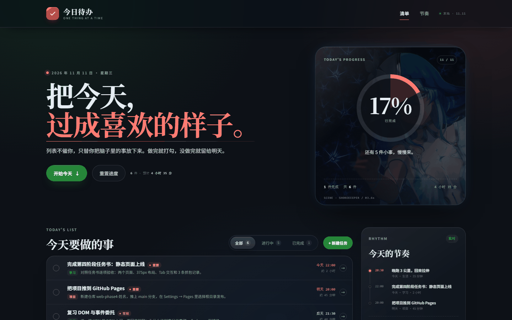
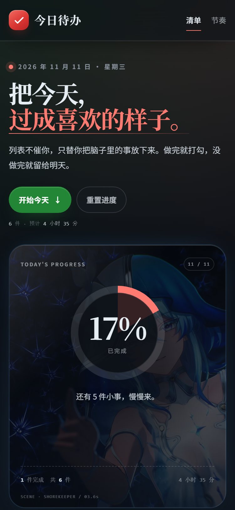
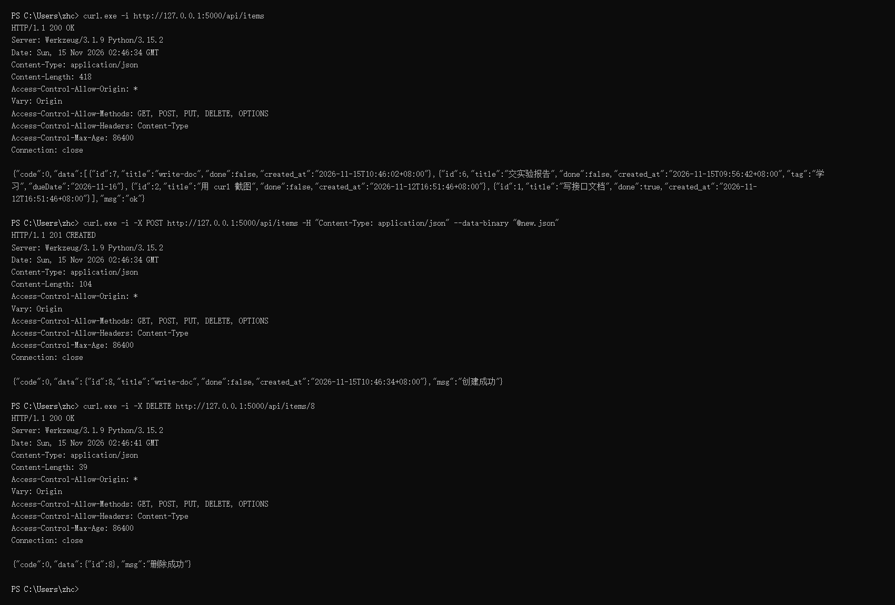
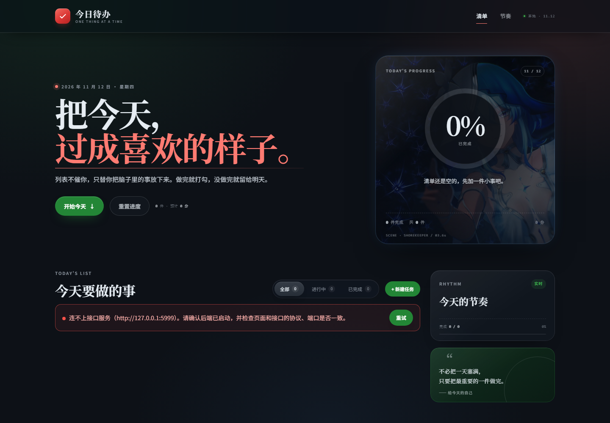
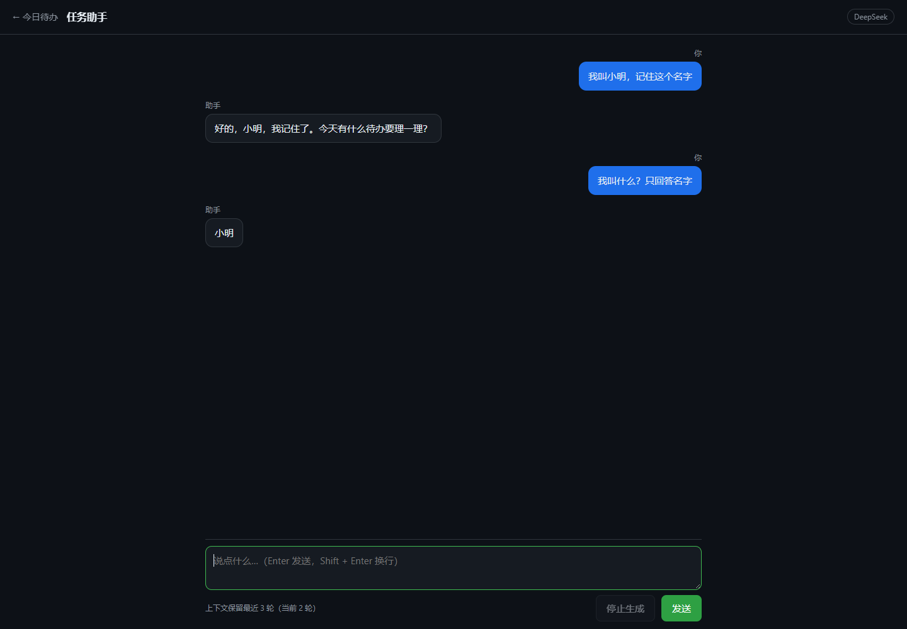
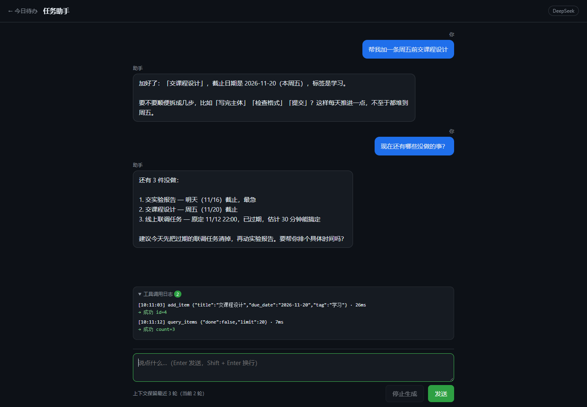
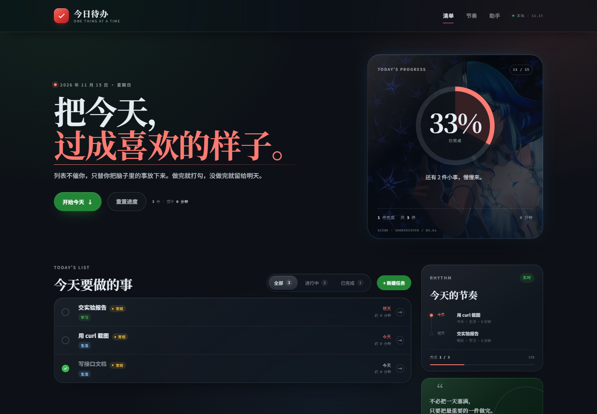

# 26级 第四阶段周记（朱恒辰）

## 一、进度

- 任务 1 静态待办页：完成
- 任务 2 三个接口 + 数据落盘：完成
- 任务 3 前后端联调（增删查闭环）：完成
- 任务 4 接入大模型，流式对话：完成
- 任务 5 工具调用，让模型操作数据：完成
- 任务 6 合成一个应用 + README + 演示：完成

## 二、实操记录

**11 月 10 日：网页和网页优化**

- 今天基本都在跟页面较劲。先把 `index.html`、`detail.html` 的骨架搭出来，CSS 变量定好颜色和间距，塞进 `data/tasks.json` 的假数据，把列表、Tab、增删改先跑通——数据是假的，但交互得像真的。
- 第一版太素，晚上换成 GitHub Dark 那套配色，标题放大，右边加了张「今日进度」的卡片。玻璃质感试多了会糊，最后只留了一点点。
- 删掉首页堆着的固定文案之后清爽不少；又把窗口压到 375px 看手机效果，标题挤成两行、按钮换行，改完终于是不横着滚了。
- 用 `http.server` 起了服务边改边看，顺手记了文档、样式、`data/tasks.json` 几类请求的状态码和耗时。




**11 月 11 日：网页优化和接口**

- 页面上线之后又补了几处：Tab 能切「全部 / 进行中 / 已完成」，点卡片能进详情，增删改的按钮也不再是摆设。
- 下午开始弄后端。建 venv 那步就被 PowerShell 拦了一回（见下面问题 1），折腾完才把 Flask 装上。
- `app.py` 先从一条 GET 写起，能返回空数组的时候还挺高兴；接着补 POST、PUT、DELETE，统一成 `{code, data, msg}`，缺字段 400、找不到 404、方法不对 405。
- 用 curl 一条条试，返回不对就改，改完再试。接口表、参数和启动命令都写进了 README，免得到时候自己都忘了怎么跑。

**11 月 12 日：前后端联调**

- 今天把页面彻底从 localStorage 上摘下来：`config.js` 只管地址，`api.js` 管请求和报错，`store.js` 里所有读写都换成 HTTP。
- 第一次打开控制台一片红——跨域。页面在 8000、接口在 5000，浏览器压根不让拿响应。一开始还想在前端绕过去，后来老实回后端加 `after_request` 回显 Origin、给 OPTIONS 返 204，世界才安静。
- 加载中、空列表、请求失败三个状态都做了，失败那条带「重试」，不然网络一抖页面就白着，看着像坏了。
- 反复试新增、编辑、删除、勾选，再按 F5，数据还在；又把后端重启一次，`app.db` 里也还在，这才敢往线上放。



**11 月 13 日：联调收尾和接入大模型**

- 上午把联调剩下的边角收掉：详情页的完成状态、错误提示、空列表、重试按钮挨个点了一遍，线上也复验了一次。
- 下午接 DeepSeek。`/api/chat` 用 SSE 一段段转发，每来一个 delta 前端就追加一个字，看起来像在打字。
- Key 只放在服务器的 `.env` 里，前端一个字都没沾——这是底线，不然等于把钥匙贴门上。
- `chat.html` 加了停止生成、3 轮上下文和错误提示，401、429、超时、余额不足都翻成中文，不让页面白屏。顺手录了段 GIF 当记录。




**11 月 14 日：工具调用**

- 今天想让模型「会干」而不只是「会说」。写了 `add_item` 和 `query_items` 两个工具，参数写成 JSON Schema，系统提示里补上今天的日期——不写它连「明天」是哪天都不知道。
- 模型只负责说「我要调 add_item，参数是这些」，真正写库的还是后端；写完把结果用 `role: tool` 塞回去，它再总结成人话。
- 前端加了个工具日志面板，工具名、参数、耗时、写进去的 id 都摊开给人看，不然根本不知道它背地里干了什么。
- 本地试「加一条明天交实验报告」和「还有哪些没做」。第一次工具描述写得太虚，模型把整句话塞进一个字符串里，后端根本拆不出标题和日期——这个失败案例留在后面讲。

**11 月 15 日：工具调用和排错**

- 早上把线上后端更新了一遍，结果先给我一个 404。以为代码传错了，查了半天才发现是免费实例 Reload 慢，`touch` 之后又等了十几秒才认。
- 这一天踩的坑比写的代码多：SSE 的换行写成字面量，前端收到一坨；PowerShell 把 JSON 的引号吃掉；PA 上传显示成功、目录却是空的；本机 `git push` 传到一半断掉。每个都记在下面了。
- 补了任务二欠的两张截图，README 按「别人照着能不能跑起来」重写了一遍。
- 最后录了 84 秒演示：首页新建 → 助手流式回答并调 `add_item` → 追问触发 `query_items` → 回首页看到新任务。




演示录屏：[`screenshots/task6-demo.mp4`](screenshots/task6-demo.mp4)（84 秒，无声；讲解词在 README 的演示分镜里）。

## 三、问题与解决

**1. PowerShell 禁止执行激活脚本**

```text
无法加载文件 C:\\Users\\zhc\\runoob-flask-test\\.venv\\Scripts\\Activate.ps1，因为在此系统上禁止运行脚本。
+ CategoryInfo : SecurityError: (:) [], PSSecurityException
```

第一次激活虚拟环境就被拦了，红字一屏。试过直接双击 `python.exe`、开 `cmd` 再激活，都能绕，但每次这么干太别扭。最后 `Set-ExecutionPolicy -Scope CurrentUser RemoteSigned`，只放宽当前用户，不动机器级策略。

**2. 虚拟环境里没有 Flask**

```text
ModuleNotFoundError: No module named 'flask'
```

一开始以为是 `app.py` 写错了，改了半天没看出问题，后来才反应过来：`python app.py` 只是 import 失败，代码根本没跑起来。在激活的 venv 里 `python -m pip install flask` 就好了；顺手把 `requirements.txt` 补上，换机器一条命令装齐。

**3. git push 传到一半断掉**

```text
send-pack: unexpected disconnect while reading sideband packet
schannel: next InitializeSecurityContext failed: CRYPT_E_NO_REVOCATION_CHECK (0x80092012)
```

试过 `http.schannelCheckRevoke=false`、`GIT_SSL_NO_VERIFY=1`、换 `HTTP/1.1`，都只是能连上，传大文件照样断。最后换成 GitHub 的 Contents API 逐文件提交：先比远端 blob 的 sha1，只传变化的文件，再建 tree、commit、更新 ref。慢一点，但没再断过。

**4. 部署后站点 500**

```text
ModuleNotFoundError: No module named 'app'
  File "/var/www/sunmoonstars_pythonanywhere_com_wsgi.py", line 7, in <module>
```

WSGI 文件里的路径明明是对的，于是进 Bash 看 `ls -la /home/Sunmoonstars/runoob-flask-test/`，只有 `.` 和 `..`——Files 里「上传成功」的提示不可信，文件根本没落盘。改成在 Bash 里直接写文件（gzip + base64 解码），`ls -l` 确认有大小，再 `touch` WSGI 触发重载，才终于起来。

**5. SSE 输出成了一坨**

```text
data: {"delta": "在"}event: tooldata: {"name": "add_item", ...}
```

换行写成了字面量 `\\n`，浏览器把整行当成一个字段。用 `curl -N` 看原始流，发现 `event:` 和 `data:` 挤在一起；改回真正的换行转义之后才一段一段地出来。

**6. PowerShell 里 curl 的 JSON 被吞**

```text
{"code":400,"data":null,"msg":"请求体必须是 JSON 对象，且 Content-Type 为 application/json"}
```

`curl.exe -d "{\\"title\\":\\"x\\"}"` 在 PowerShell 里引号会被重新解释，body 变成残缺的 JSON。一开始以为是后端解析写错了，后来把 body 写成 UTF-8 无 BOM 文件、用 `--data-binary "@body.json"` 发就正常了。

## 四、知识点

**状态码**：三位数字，第一位是类别。2xx 是成功（200 查到、201 新建成功），4xx 是客户端的问题（400 参数不对、404 记录不存在、405 方法不对），5xx 是服务端自己的错。统一用 200 再包一层 `code` 看着省事，但浏览器、监控、代理都只认 HTTP 状态码，真出问题时反而看不出是哪一类，所以这里参数错就老老实实返 400。

**CORS**：浏览器有同源策略，页面在 8000、接口在 5000 就算跨源，默认拿不到响应。跨源请求前浏览器会先发一个 OPTIONS 预检，服务端得在响应里带 `Access-Control-Allow-Origin` 这些头，预检过了才发真正的请求。这件事只能服务端解决，前端改不了，也不该去关浏览器安全策略。

**Function Calling**：把「模型能做什么」写成一份 JSON Schema 交给模型。模型不直接执行，只返回「我要调 `add_item`，参数是这些」；真正的读写由后端做，做完再把结果以 `role: tool` 的消息塞回对话，模型基于结果说人话。这样权限和校验都在自己手里，模型只能提要求。

## 五、本周总结

最大的收获是「一条链路真的通」：页面上一个动作，经过 HTTP、参数校验、SQLite、模型和工具调用，最后能看到数据库里多了一条。这种闭环，比单独写个页面或者单独调个模型都更能说明问题。另一个收获是排错方法——先看原始返回（`curl -N`、`ls -la`），再猜原因，比闷头改代码快得多。

仍然没弄懂的是 SSE 的工程化细节：断线重连、多个标签页同时订阅、长连接在代理后面的超时处理，目前都只是「能跑」。SQLite 的并发写入和迁移也只知道皮毛。

下一阶段想学鉴权和多用户（现在线上库谁都能改），以及把部署做成能自动跑的流程，而不是每次手动传文件。
