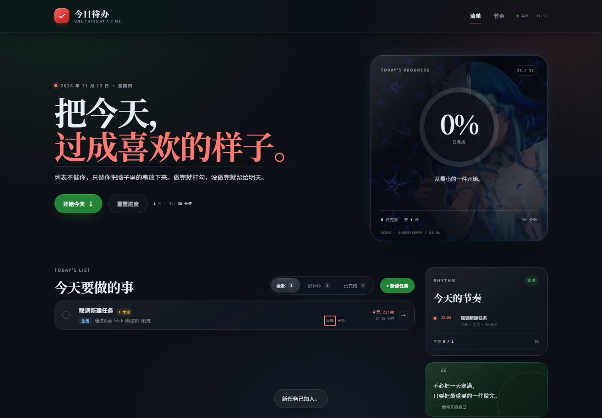
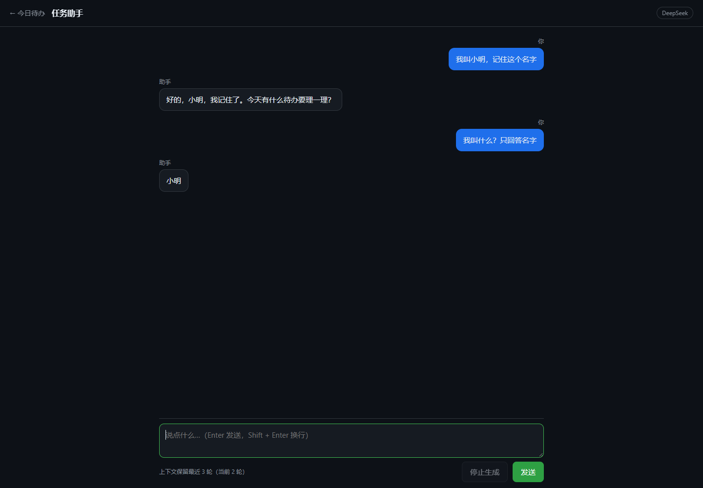
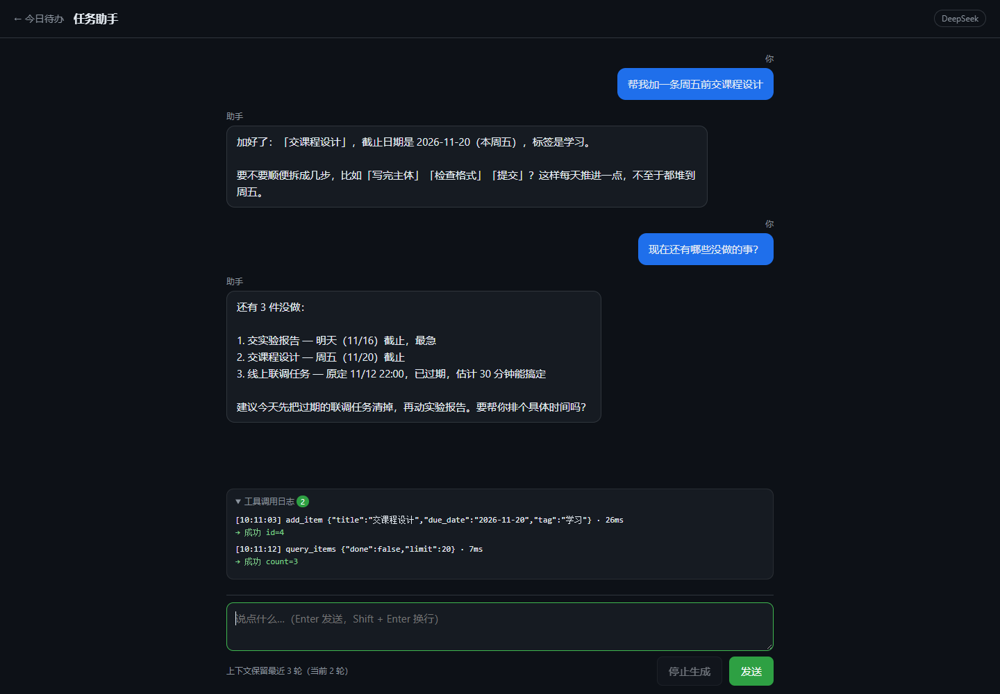
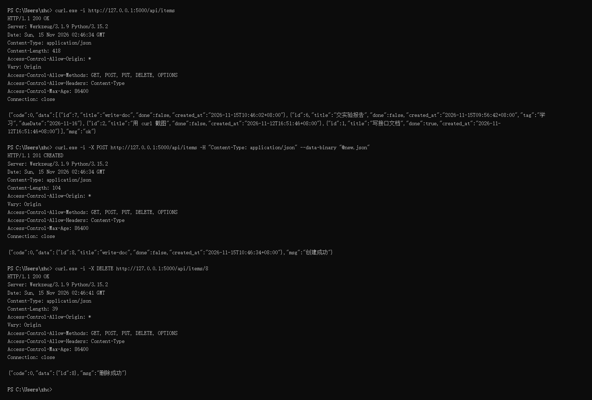
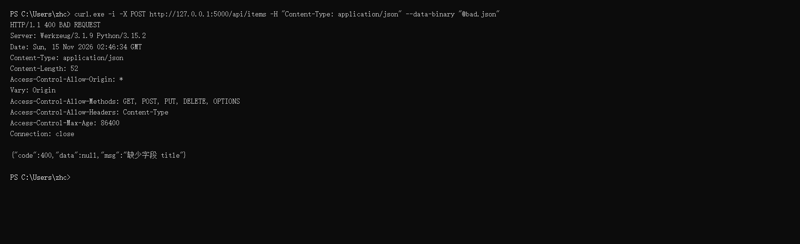

# 今日待办 · 任务助手

一个把「今天的待办」和「跟 AI 说一句话就记下来」放进同一个页面的小应用。清单、详情、助手三个页面共用一套 Flask 接口和一个 SQLite 库，助手通过工具调用直接读写这些待办，不是另一个聊天玩具。

- 线上：https://a-sun-moon-stars.github.io/wangye/
- 助手：https://a-sun-moon-stars.github.io/wangye/chat.html
- 演示：https://a-sun-moon-stars.github.io/wangye/screenshots/task6-demo.mp4 （84 秒，无声）
- 后端仓库：https://github.com/a-sun-moon-stars/runoob-flask-test
- 线上接口：https://sunmoonstars.pythonanywhere.com/api/items

## 使用要点

- 新建和编辑时所有字段都可以留空，标题空着会自动存成「未命名任务」。
- 增删改都直接写库，刷新页面或换台设备再打开，清单还是最后的样子。
- 顶部搜索框实时过滤当前清单：标题、描述、标签、备注、步骤里的词都能搜到；按 Esc 清空。

## 技术栈

| 层 | 选型 | 说明 |
| --- | --- | --- |
| 前端 | 原生 HTML / CSS / JavaScript | 无框架，`fetch` 调接口，`EventSource` 之外用 `fetch` 流读 SSE |
| 后端 | Python 3.10 + Flask 3.1 | 单文件 `app.py`，`sqlite3` 标准库，无 ORM |
| 数据库 | SQLite | 一个 `app.db` 文件，`items` 表 + `extra` JSON 列 |
| 模型 | DeepSeek `deepseek-chat` | 后端转发，流式返回；工具调用走 OpenAI 兼容的 `tools` 协议 |
| 部署 | GitHub Pages + PythonAnywhere | 前端静态托管，后端 WSGI |

## 目录结构

```text
wangye/                    # 前端仓库
├── index.html             # 清单页
├── detail.html            # 单条任务详情
├── chat.html              # 任务助手（流式对话 + 工具日志）
├── css/                   # style / refresh / api-state / chat
├── js/
│   ├── config.js          # 接口地址（唯一配置点）
│   ├── api.js             # 统一请求、超时、错误文案
│   ├── store.js           # 数据存取，全部走接口
│   ├── app.js             # 清单页交互
│   ├── detail.js          # 详情页
│   └── chat.js            # 对话、SSE 解析、工具事件渲染
└── screenshots/           # 功能与验收截图

runoob-flask-test/         # 后端仓库
├── app.py                 # 路由、校验、CORS、流式对话、工具调用
├── requirements.txt
├── .env.example           # 环境变量示例
└── pythonanywhere_wsgi.py # 部署用 WSGI 配置
```

## 本地运行

前置：Python 3.10+、能访问 `api.deepseek.com` 的 DeepSeek Key。

**1. 后端**

```powershell
git clone https://github.com/a-sun-moon-stars/runoob-flask-test.git
cd runoob-flask-test
python -m venv .venv
.\.venv\Scripts\Activate.ps1
python -m pip install -r requirements.txt
copy .env.example .env      # 然后把 .env 里的 Key 换成自己的
python app.py
```

`.env` 内容：

```text
DEEPSEEK_API_KEY=sk-你的Key
DEEPSEEK_MODEL=deepseek-chat
```

`.env` 已在 `.gitignore` 里，不会进仓库；Key 只从服务端环境变量读，前端 JS 里没有。

**2. 前端**

```bash
cd wangye
python -m http.server 8000
```

打开 `http://localhost:8000/index.html?api=http://127.0.0.1:5000`，助手是 `chat.html?api=http://127.0.0.1:5000`。不带 `?api=` 时连线上接口；地址集中在 `js/config.js`。

**3. 验证**

```bash
curl.exe http://127.0.0.1:5000/api/items
curl.exe -N -X POST http://127.0.0.1:5000/api/chat -H "Content-Type: application/json" -d "{\"messages\":[{\"role\":\"user\",\"content\":\"帮我加一条明天交实验报告\"}]}"
```

第一条返回 `{"code":0,...}`；第二条先出现 `event: tool`（`add_item`），再逐字返回自然话。

## 功能截图

清单页，三态与接口渲染（`screenshots/task3-success.png`、`task3-empty.png`、`task3-error.png`）：



助手页，流式输出与三轮上下文（`screenshots/task4-online.png`）：



工具调用：说一句话，模型调 `add_item` 写库，日志区显示工具名、参数、耗时、结果（`screenshots/task5-online.png`）：



接口验收：GET / POST / DELETE 分别返回 200 / 201 / 200（`screenshots/task2-api.png`），参数类型不对（`title` 传数字）返回 400 和中文原因，不是 500（`screenshots/task2-400.png`）：




## 已知问题

- PythonAnywhere 免费实例有 CPU 秒数限额，闲置一段时间后第一次请求会慢（Reload 也要等几秒）。
- 没有登录和鉴权，线上库里谁都能增删；这是课程演示用，不对外。
- 工具调用最多 2 轮、每轮最多 3 个，防止模型来回打转；对话上下文只保留最近 3 轮，超长从最早丢。
- SQLite 是单文件，只适合单实例部署，不能多副本同时写。
- 本机 `git push` 在这台 Windows 上经常被 schannel 中断，仓库更新走了 GitHub API；换机器不受影响。
- 移动端只按 375px 宽度验过，没有做平板和横屏适配。
